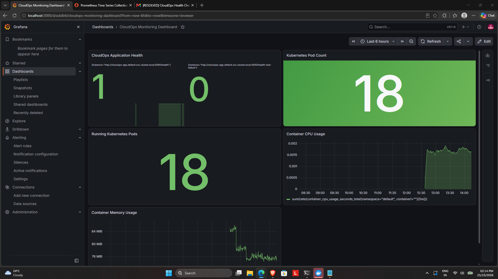
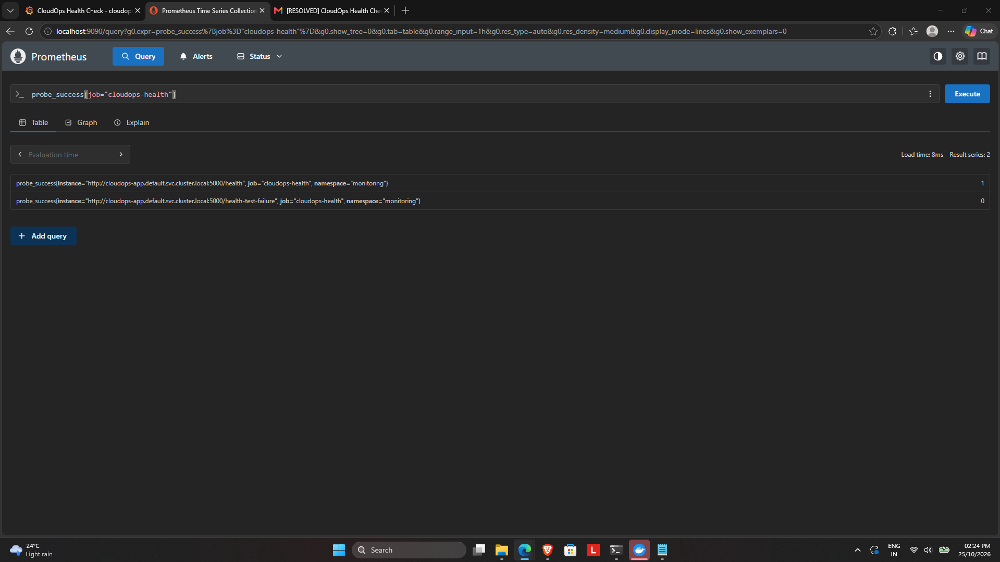
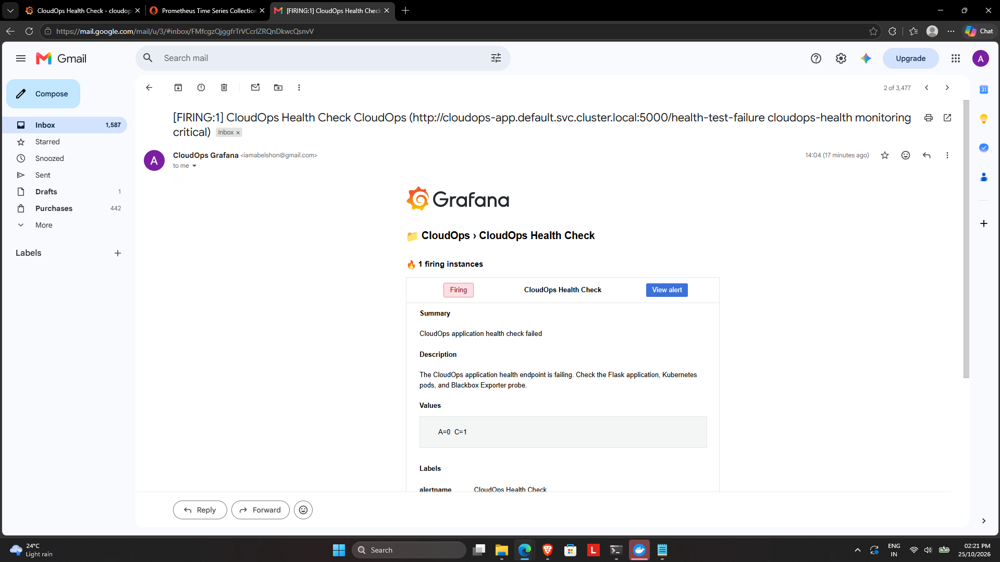
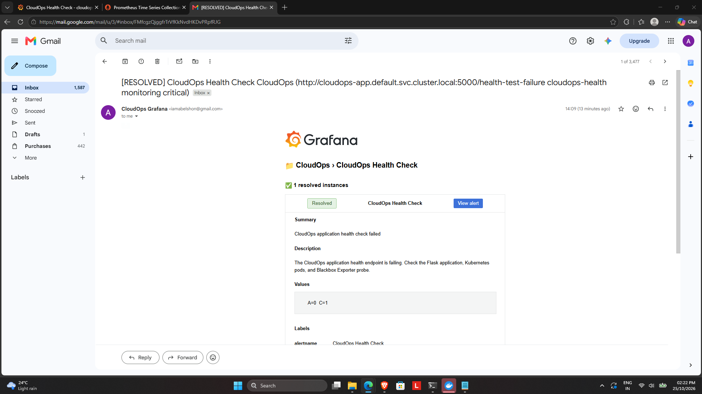

# CloudOps Platform

A hands-on DevOps and CloudOps project demonstrating containerization, Kubernetes orchestration, CI automation, monitoring, health checks, and email alerting.

## Project Overview

CloudOps Platform runs a Python Flask application in Docker and deploys it to a local Kubernetes cluster. GitHub Actions runs automated tests and builds the Docker image. Prometheus collects monitoring metrics, Grafana provides dashboards and alert rules, and Blackbox Exporter checks the application's HTTP health endpoint.

## Architecture

```text
Developer
   |
   v
GitHub Repository
   |
   v
GitHub Actions CI
   |-- Run Python tests
   |-- Build Docker image
   |
   v
Docker + Kubernetes (Minikube)
   |-- Flask application
   |-- 3 replicas
   |-- Kubernetes health probes
   |
   v
Prometheus <--- Blackbox Exporter
   |                  |
   |                  v
   |             /health endpoint
   v
Grafana Dashboard and Alert Rules
   |
   v
Email Notifications
```

## Technologies Used

- Python and Flask
- Docker
- Kubernetes and Minikube
- kubectl
- Git and GitHub
- GitHub Actions
- Helm
- Prometheus
- Grafana
- Prometheus Blackbox Exporter
- YAML

## Features

- Flask application with a health endpoint.
- Docker image build.
- Kubernetes deployment with three replicas.
- Kubernetes health probes and pod self-healing.
- Automated Python tests through GitHub Actions.
- Automated Docker image build in CI.
- Prometheus monitoring.
- Blackbox HTTP health checks.
- Grafana dashboard for application health, pods, CPU, and memory.
- Grafana alert rules with email notifications.
- Failure and recovery testing.

## Application Endpoints

| Endpoint | Purpose |
|---|---|
| `/` | Application status information |
| `/health` | Health check endpoint |

The application listens on port `5000`.

## Local Project Structure

```text
cloudops-platform/
├── app/
├── tests/
├── k8s/
│   └── deployment.yaml
├── docs/
├── scripts/
├── .github/
│   └── workflows/
│       └── ci.yml
├── Dockerfile
├── requirements.txt
└── README.md
```

## Project Screenshots

### Grafana Dashboard


### Health Check Failure and Recovery


### Grafana Alert Notification


### Alert Resolution

## Monitoring and Alerting

Prometheus scrapes the Blackbox Exporter probe for the application health endpoint. Grafana uses the `probe_success` metric to identify failures.

The alert rule checks:

```promql
probe_success{job="cloudops-health"}
```

- `1` means the HTTP health check succeeded.
- `0` means the health check failed.

When the metric remains below `1` according to the alert rule's evaluation and pending settings, Grafana can fire an alert and send an email notification.

## Validation and Testing

The following checks have been performed:

- Python unit tests passed.
- GitHub Actions CI checks passed.
- Kubernetes deployment reached three ready replicas.
- Pod deletion triggered Kubernetes replacement of the deleted pod.
- Prometheus reported a successful application health check.
- A controlled health-check failure caused the Grafana alert to fire.
- The alert email was received.
- The original health endpoint was restored and the metric returned to `1`.
- Grafana returned to Normal after recovery.

## Running the Application

Prerequisites: Python, Docker, kubectl, and a running local Kubernetes cluster such as Minikube.

Run the Python tests:

```bash
python -m unittest discover -s tests -v
```

Build the Docker image:

```bash
docker build -t cloudops-app:1.0 .
```

Deploy to your configured local Kubernetes cluster:

```bash
kubectl apply -f k8s/deployment.yaml
kubectl get pods
```

The Kubernetes deployment uses the local image `cloudops-app:1.0`; ensure the image is available to your cluster before deploying.

## Accessing the Application

Use port forwarding:

```bash
kubectl port-forward service/cloudops-app 8080:5000
```

Then open `http://localhost:8080`.

To access the health endpoint, open `http://localhost:8080/health`.

## Project Goals

This project demonstrates practical experience with CI/CD, containerization, Kubernetes deployments, observability, alerting, troubleshooting, and recovery validation.

## Future Improvements

- Add screenshots of the Grafana dashboard and alert states.
- Add infrastructure automation.
- Expand automated tests.
- Add a documented deployment and troubleshooting guide.
